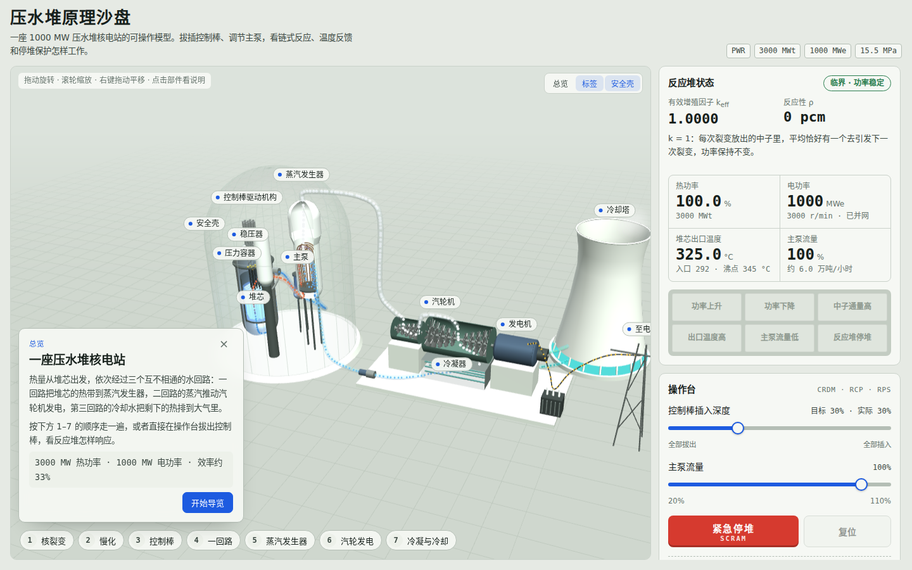

# 压水堆原理沙盘

一座 1000 MW 压水堆（PWR）核电站的可操作三维模型。拔插控制棒、调节主泵，看链式反应、温度反馈和停堆保护怎样工作。

**在线访问：<https://fuzzylogic112.github.io/pwr-sandbox/>**



## 能做什么

- **三维电站**：压力容器与堆芯剖视、控制棒及驱动机构、稳压器、主泵、蒸汽发生器、汽轮机、发电机、冷凝器、冷却塔。冷却剂、蒸汽和冷却水用流动的小球表示，颜色代表温度或相态。
- **分步导览**：从“核裂变”到“冷凝与冷却”共 7 步，镜头自动飞到对应部件并给出讲解。点击任意部件或标签也能看说明。
- **操作台**：控制棒插入深度、主泵流量、紧急停堆（SCRAM）与复位。
- **实时读数**：k<sub>eff</sub>、反应性（pcm）、热功率、电功率、堆芯出口温度、主泵流量，报警光字牌，近 2 分钟功率趋势图。
- **中子示意**：堆芯截面里快中子慢化为热中子、引发裂变、被控制棒吸收的过程，中子数量随功率变化。

### 试一试

| 操作 | 会看到 |
| --- | --- |
| 把控制棒从 30% 拔到 25% | 功率上升，温度升高后负反馈把 k 拉回 1，功率停在约 109% |
| 拔出全部控制棒 | 功率冲过 115%，触发“中子通量高”紧急停堆 |
| 主泵降到 50% | 出口温度升高，超过 340 °C 触发停堆 |
| 按紧急停堆 | 控制棒约 2 秒落入堆芯，裂变停止，但仍有百分之几的衰变热 |

## 操作方式

| | 电脑 | 手机 / 平板 |
| --- | --- | --- |
| 旋转 | 左键拖动 | 单指拖动 |
| 缩放 | 滚轮 | 双指捏合 |
| 平移 | 右键拖动（或按住 Shift 拖动） | 双指拖动 |
| 查看说明 | 点击部件或标签 | 轻点部件或标签 |

## 物理模型

页面用的是简化的点堆动力学模型，参数取示意值，动态过程已加速：

- 控制棒积分价值约 7000 pcm，采用 S 形积分曲线；
- 燃料温度（多普勒）反馈与慢化剂温度反馈均为负值，功率会自己稳定下来；
- 衰变热约为运行功率的 6.5%，停堆后缓慢衰减；
- 停堆整定值：中子通量 115%、堆芯出口温度 340 °C、主泵流量 30%。

读数不代表任何实际机组，仅用于理解原理。

## 本地运行

纯静态页面，没有构建步骤：

```bash
git clone https://github.com/FuzzyLogic112/pwr-sandbox.git
cd pwr-sandbox
python3 -m http.server 8000
# 浏览器打开 http://localhost:8000
```

也可以直接双击 `index.html` 打开。

## 技术说明

- 单文件 `index.html`，原生 JavaScript + [three.js](https://threejs.org/) r128。
- three.js 放在 `vendor/` 目录随仓库发布（MIT 许可，见 `vendor/three.LICENSE`），不依赖外部 CDN。
- 网页字体从 Google Fonts 异步加载，加载失败时自动使用系统字体，不影响页面打开。
- 自动跟随系统的浅色 / 深色模式。
